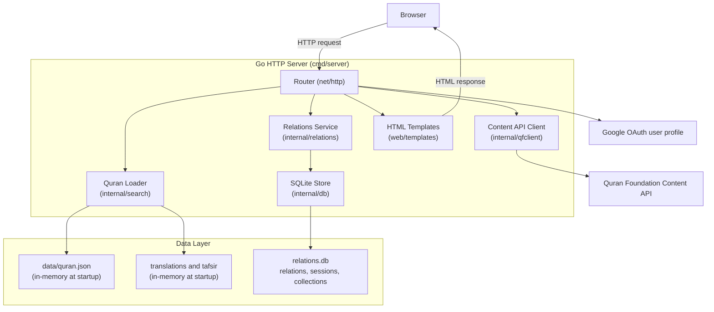
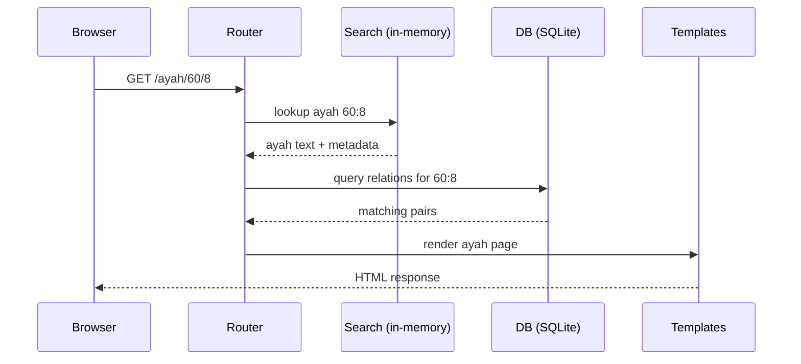

# Architecture

This document describes the system architecture.

## System overview

The application consists of five main parts:

1. Local Quran, translation, and tafsir datasets
2. Go backend server
3. SQLite persistence
4. Server-rendered frontend
5. Optional Google identity verification and Quran Foundation audio content



## Technology constraints

- Backend: Go, the standard library, `net/http`, and SQLite. Do not add a web
  framework or ORM.
- Frontend: server-rendered HTML templates, CSS, and small amounts of JavaScript.
  Do not add a JavaScript framework or a Node.js/npm build toolchain.
- Keep Quran text complete and Arabic text readable in the interface.

## Quran dataset

Primary file:

- `data/quran.json`

Loaded into memory at server startup.

Each record:

- `surah`
- `surah_name`
- `ayah`
- `juz`
- `text_ar`

### Data ingestion flow

1. source dataset is placed in `data/raw/` (optional workspace)
2. transform/normalize into project schema
3. write output to `data/quran.json`
4. run validation checks
5. commit generated dataset and attribution updates

### Validation rules

- total records: `6236`
- unique key: `(surah, ayah)`
- non-empty Arabic text for `text_ar`
- valid surah range: `1..114`

## Backend

The backend is a Go HTTP server.

Responsibilities:

- Load Quran, translation, and tafsir datasets.
- Handle public, account, collection, and administration routes.
- Store relations and account-specific state in SQLite.
- Import versioned curation suggestions into a private admin review queue.
- Verify user identity through Google OAuth and load verse audio through the
  optional Quran Foundation Content API.
- Render and serve HTML pages and static assets.

## Database

SQLite database.

The database stores mutable application state. Quran text, translations, and
tafsir remain in versioned JSON files and load into memory at startup.

Primary tables:

- `relations`: curated ayah pairs, categories, highlights, source, and review
  state.
- `curation_candidates`: automatically detected ayah pairs, provisional
  category suggestions, and pending/accepted/rejected review decisions. The
  review page also suggests editable word highlights against unchanged Quran
  text. Pending candidates are excluded from public relation queries;
  individual acceptance inserts a reviewed relation and its selected highlight
  indices in the same SQLite transaction. Bulk acceptance publishes automatic
  relations with manual review still pending. Accepted candidates link to a
  stable relation ID; admin groups use the relation's review flag. Review or edit
  actions update that flag and the admin-only note, reviewer, and UTC timestamp
  together. Automatic provenance remains intact after human review, and internal
  notes are excluded from public relation data.
- `users`: Google subject identifier, verified email, profile name, and sign-in
  timestamps.
- `sessions`: expiring HifzLink sessions. Google OAuth tokens are not retained.
- `collections`: user-created murojaah collections.
- `collection_items`: saved ayahs and pairs, including mastery state.

The admin user overview reads account identity, last sign-in, active-session
status, and aggregate collection/item counts. It does not expose notes or verse
content.

Schema changes use additive migrations in `internal/db`.

## Folder structure

- `cmd/server/main.go`
- `cmd/server/home.go`: homepage and sample continuation practice handlers
- `internal/db`
- `internal/relations`
- `internal/search`
- `web/assets.go`: embeds templates and browser assets into the release binary
- `web/templates`: server-rendered page templates
- `web/static`: shared tokens/components, page styles, and small behavior scripts
  (`home.css`, `practice.css`, `catalog.css`, and `practice.js` for the learning flow)
- `data/quran.json`
- `data/translations`
- `data/tafsir`
- `data/relations.seed.json`

Templates and browser assets are embedded in the executable so a versioned
binary serves a matching UI. Quran reference data and SQLite remain file-backed.

## Request flow

Example: `GET /ayah/60/8`



## Compare mode

Compare view supports both the original two-verse comparison and a multi-verse
view. The multi-verse route takes one `ayah1` anchor and repeated `ayah2`
references, renders the anchor once, and shows a full verse card for each
selected connection. Pair-specific relation highlights are applied per card;
translations are collapsed by default across comparison views to keep them
compact.

The ayah page provides the selection form. Surah and juz pages remain browse
entry points, while selected connections are compared together from the ayah
page.

## Performance

The Quran dataset is small enough for full in-memory loading.

This keeps verse lookup fast and simple.

## Deployment

Run the local server with one command:

```bash
go run ./cmd/server
```

The same Go binary serves staging and production. Each environment uses its own
configuration and SQLite database. Develop on a feature branch, merge through
`staging`, verify the result, and promote the verified commit to `main` through
a pull request. Operational deployment configuration is maintained outside this
public source repository. The former legacy production branch is retained only
under its archive tag.

## Design philosophy

Keep everything simple.

Avoid unnecessary dependencies.

Prioritize clarity, maintainability, and accurate Quran text handling.
